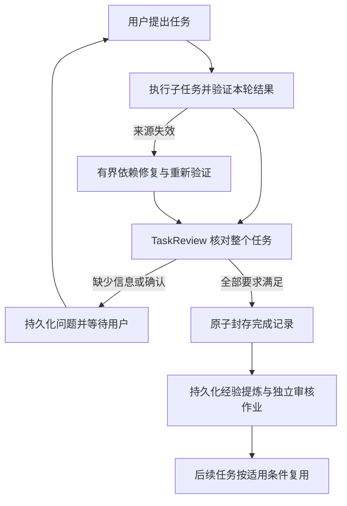

# 任务级自动闭环

状态：Implemented / experimental，2026-10-31。`multi_fixed` 默认启用，`single` 的执行流程保持原状。
Python 调用方可用 `task_lifecycle_enabled=False` 单独验证协作基础层；旧专项 Smoke 已显式使用此选项。

## 自动路径

一次 FINAL_RESPONSE 或子任务 PASS 只完成本轮/子目标，不等于任务完成，也不构成用户批准。
TaskReview 根据当前有效目标、约束、跟踪问题和依赖逐项给出结构化评估，使用原始 USER
消息与已验证成果；必须覆盖所有 required_entry ID，支持 artifact ID 必须真实存在。
只有所有要求 SATISFIED、支持非空、没有剩余要求且没有待问问题才允许 COMPLETE。
否则 WAITING_USER 必须携带具体问题和剩余要求。语义判断没有关键词或正则捷径。

## 完成记录与经验来源

Task 3 的 task_completion_receipts 在同一个 SQLite 事务中比较完整 Ledger 快照、
设置 COMPLETED 并写入完成记录。记录包含验收提案、来源运行/结果哈希、受认可来源前沿，
以及完成后的 Ledger 哈希。经验校验只对该记录明确认可的运行接受正常 ACTIVE→COMPLETED
变化；不会忽略任意状态、目标、约束或证据变化。

已有有效经验的同任务来源在封存时重新校验并纳入认可列表。完成后的强行重开、目标修改、
记录损坏都会拒绝；没有完成记录的旧版手工状态改变不会被猜测迁移。
完成记录证明历史验收，不能使被撤销的成果、变化的文件或失效经验永久有效。

## 持久化调度与恢复

coordination.db 保存 task_cycles、lifecycle_jobs、lifecycle_deliveries。
ASSESS 和 LEARN 是独立、可恢复作业，输入身份与内容有哈希校验；同一来源/触发身份幂等。
新结果会淘汰同任务旧的待验收作业，调度优先处理新的待处理记录。
同一任务的调度通过进程间文件锁互斥。

完成封存与 coordination 作业更新跨数据库，不宣称分布式原子性：如果 Task 3 已提交、
经验 outbox 尚未提交就中断，恢复时读取已核验的完成记录，继续原作业，补齐经验作业。
模型提案、审核阶段和预算复用既有持久缓存，绝不以重启重置调用额度。

待问问题也会加入当前返回给用户的回答；整体验收通过后明确显示完成状态。
问题和事件采用可恢复投递：稳定 event ID、稳定对话 turn ID，以及投递确认。
投递后确认前中断时可安全重投，避免丢问题或重复发问。取消任务停止待处理作业。
完成任务的学习失败不会伪装成已保存经验，也不会推翻已经通过的任务验收。

调度在轮次前后、会话恢复和显式 drain 时执行。每次默认处理最多 3 个修复队列项、
4 个任务作业；每个验收最多评估 64 个条目。没有常驻后台文件监听器。
已结束任务不因外部文件变更而偷偷重开；旧答案和经验仍执行来源校验，失效后需要新任务核验。
新用户请求开始前会解除完成/取消任务的活动绑定，由 Provider 正常绑定新任务。

## 用量与终态

来源协作、修复、任务验收、经验提炼分别使用持久化运行预算。每个验收阶段调用一次
TaskReview 阶段，经验提炼使用既有提案与审核两个阶段。Provider 内部重试仍关闭。任务闭环模式对结构化响应格式错误最多显式重试一次，两次请求分别在同一 run 预约和结算，第二次仍受原预算/时限限制；不重试网络错误、不本地猜测修补内容，也不重复工具执行。再次失败则停止，失败作业不无限重试。
状态接口的 usage 汇总整个 task 的已记录模型调用与核算单位，包括自动作业。

任务调度状态明确区分 ASSESS_PENDING、REPAIR_PENDING、WAITING_USER、FAILED、COMPLETED、CANCELLED。
任务完成与经验状态分开记录，经验可为 ACTIVE、ABSTAIN、NEEDS_CONFIRMATION 或失败。
没有把每次成功回答都无条件存成经验，也没有并行工作者、策略训练或正式性能结论。

## 使用与验收

CLI：`/task-loop` 查看状态；`/task-drain` 继续待处理作业；`/complete` 在此模式下须通过
完整验收才能封存；`/cancel` 同时停止待处理作业。通常只需正常提出任务和补充必要输入。
JSONL：`task/lifecycle/read`（可选 taskId）、`task/lifecycle/drain`，均可指定 threadId。
`status/read` 和返回结果的 trace_metadata.task_lifecycle 也包含状态，initialize 声明 taskLifecycle。

离线：`code/tests/test_task_lifecycle.py`。覆盖两个连续任务、正常完成后的来源资格、
输入变化修复、中断窗口、通知去重、取消、伪造覆盖、封存/作业篡改与并发条目变化。
全量结果见 `docs/evaluations/task-lifecycle-20261031.xml`；真实 API 证据以
`docs/evaluations/live-task-lifecycle-20261031.json` 的 engineering_assertions_passed 字段为准。

真实连续任务用例通过六项断言。第二个任务的新经验提案因来源门禁不通过而被拒绝，任务本身仍正常完成；未把拒绝当成写入成功。最终又补充了学习失败时保留 completion_id 和显式 FAILED 经验状态的回归。

待澄清经验可通过 `/experience review` 明确确认，或通过 `/experience revoke` 拒绝。系统追加独立的解决记录，保留原始问答和投递历史，清除待办；后续 drain 不会重发已解决的问题。该分支由闭环专项回归覆盖。
