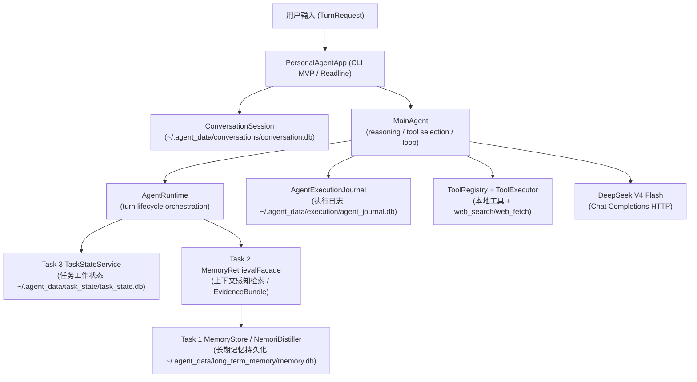

> 历史状态说明：2026-10-14 的维护报告记录了当日 UI 清理和 CLI/JSONL 入口；下文为截至 2026-09-05 的进展快照。当前多 Agent 架构与验证见 [P1 架构说明](../architecture/multi-agent-foundation.md) 和 [阶段报告](../phases/multi-agent-p0-p1-20261014.md)。

# MAPAS 项目进展总览

> **文档定位与时点**
>
> 本文档是 2026-09-05 的历史进展快照，按当时的代码和 Git 历史记录设计目标、验收状态、限制和后续计划。
> 项目于 2026-10-20 更名为 MAPAS；当前多 Agent 状态见 [P1 架构说明](../architecture/multi-agent-foundation.md) 与 [阶段报告](../phases/multi-agent-p0-p1-20261014.md)。
>
> **同步日期**：2026-09-05
> **当前全量回归**：`386 passed`（隔离测试数据）
> **分支状态**：`main` 是唯一维护分支；旧 `master` 历史已合入并删除远程分支。

---

> **当前状态摘要（一览表）**

| 模块 / 阶段 | 状态 | 主要能力 | 当前结论 |
|---|---|---|---|
| Task 1 长期记忆生命周期 | **已完成 / 冻结** | MemoryItem、MemoryRevision、生命周期操作、SQLite 持久化 | 通过验收，tag `phase-1c-task1-frozen` |
| Task 2 上下文感知记忆检索 | **已完成 / 冻结** | 多路召回、Applicability 判断、EvidenceBundle 生成 | 通过验收，tag `phase-2g-task2-final` |
| Task 3 任务工作状态 | **核心冻结 + 运行时修补** | TaskLedger、ContinuationCheckpoint、StructuredTaskContext、Invalid Proposal 容错恢复 | 通过验收，tag `phase-3d-task3-final`；当前发布分支包含 post-freeze 容错修补 |
| AgentRuntime | **已完成 / 冻结** | Turn 生命周期编排、Task2+Task3 集成 | 通过验收，tag `phase-4a-agent-runtime-final` |
| MainAgent 机制 v1.2 | **历史冻结 (HISTORICAL BASELINE)** | reasoning 循环、工具执行、Journal 持久化、crash 恢复 | tag `main-agent-mechanism-v1.2` = `473d8c6c` |
| MainAgent 机制 v1.3 | **历史冻结 (HISTORICAL BASELINE)** | v1.2 + 持久化 Conversation Session Context (Short-Term Dialogue Context) | tag `main-agent-mechanism-v1.3` = `f23bf9cb` |
| Current Release 状态 | **ACTIVE MAIN** | Phase 4D 加固 + Codex-style event host、可恢复 turn、工具目录/审批事件、工作区搜索/patch、MCP stdio | 唯一维护分支为 `main`；记忆更新相关回归 83 passed，Product Trial 14/14；全量另有 4 个既有环境/基线失败 |
| Conversation Session | **已完成 / 部署** | ConversationSession / Message 领域层、完整 Transcript 持久化、模型感知窗口与 compaction checkpoint | 彻底解耦 `session_id != task_id`；不再使用产品级 8条/6000字窗口，`/context` 可查看投影状态 |
| 显式长期记忆 (/remember) | **通用架构已完成 / 测试验证 PASS** | 路由至 `NemoriDistiller.propose_explicit_lifecycle` → `LifecycleProposal` → 校验 → 原子提交 | 零生产硬编码（642fbd 被 REJECT，bad9e0b 恢复通用路由）；已完成 DeepSeek 初始语义 Smoke，广泛质量评测仍待补充 |
| 自动长期记忆 (Auto Memory) | **实验性 (EXPERIMENTAL / Agent-selected)** | Agent 自主选择 `update_long_term_memory` 内部工具 + Provider/NEMORI typed lifecycle + `INFERRED` 来源追踪 | 每轮提供调用机会；不再使用隐藏的轮数/时间触发器，抽取质量仍需真实 Provider 实验 |
| Phase 4C 运行时加固 | **已实现 / 历史阶段** | Prompt DTO、幂等、provenance、Conversation 并发、配置/衰减/重试边界 | 历史阶段记录；当前回归以 main 为准 |
| Phase 4D 失败真实性加固 | **已实现 / 历史阶段** | 禁止占位成功、完整事件身份、工具结果互斥、脱敏诊断、Harness 失败闭合 | 历史阶段记录；当前回归以 main 为准 |
| 动态事实约束 (Grounding) | **工具能力已接入 / 持续扩展** | `web_search`、`web_fetch`、`weather` 只读工具 + URL 安全校验 + 来源/抓取时间 | 搜索、网页抓取和天气已可用；新闻、股票等专用工具尚未接入 |
| 交互式 CLI MVP | **已完成 / 可用** | 交互式终端 CLI、GNU readline 行编辑、历史持久化 (`~/.agent_data/cli/cli_history`)、Session/Task 指令 | 入口 `python3 scripts/personal_agent.py`；详见 `docs/usage.md` |
| Autonomous Product Trial Harness | **就绪 / 14 场景 PASS** | 100% 临时目录隔离、Hard Oracle、Observer、Seeded Fuzz (50 步)、Overfit Guard | 脚本 `python3 scripts/personal_agent_trial.py`；14/14 场景全部 PASS |
| Virtual-User Explorer | **STUB / 确定性存根** | 基于预定义脚本的测试驱动 | 未实现开放式 LLM 自由探索虚拟用户 |
| Autonomous Code Fixer | **DISABLED / 禁用** | 防过拟合守卫 (Overfit Guard) 已建立 | 禁用自动修代码，避免过拟合生产算法 |
| 真实 Provider 传输层 | **DeepSeek 适配完成** | 固定 DeepSeek Chat Completions、`deepseek-v4-flash`、JSON Output、thinking、用量统计 | 本地协议回归 PASS；真实语义质量仍需持续评测 |
| 官方 Tier A 语义基线评估 | **NOT COMPLETED** | — | 历史评估被 ABORTED；未运行 120B/20B 语义质量基线 |
| Task 4 人格/认知模块 | **暂缓 (DEFERRED)** | — | 尚未启动 |

---

## 第一部分：项目目标

### 1.1 这个项目最终想构建什么

本项目的目标是构建一个**长期运行的个性化智能 Agent 系统**（Personal Agent / Agent Memory System）。

它与普通的对话式 Chatbot 有本质区别。一个简单 Chatbot 只需要处理当前对话窗口内的内容，不需要跨对话记忆任何东西，也不需要理解"这个用户的长期偏好是什么"或者"这个任务上一次做到哪里了"。

本项目构建的系统同时具备：

- **长期记忆 (Task 1)**：能够跨越多次对话、多天甚至更长时间，记住与用户相关的信息
- **记忆生命周期管理 (Task 1)**：知道哪些记忆是当前有效的，哪些已经被新信息更新，哪些已经被明确纠正
- **上下文相关检索 (Task 2)**：不是简单地把所有记忆按相似度排列返回，而是知道当前情境下哪些记忆真正适用
- **任务状态管理 (Task 3)**：记住当前任务做到了哪一步，有哪些约束、决定和待解问题
- **对话会话连续性 (Conversation Session)**：持久化维持连续用户/助手对话历史，跨会话隔离与跨重启恢复
- **Working Context 组合 (AgentRuntime)**：把记忆、任务状态与对话历史综合组装成适合给模型消费的上下文
- **Agent Reasoning (MainAgent)**：能够进行多步推理，决定下一步是直接回答还是需要调用工具
- **工具调用与副作用确认**：能够选择正确的工具，所有副作用操作（如文件修改）必须等待用户确认
- **故障恢复**：系统崩溃或重启后能够恢复到正确状态，不会丢失关键执行记录
- **持久化**：记忆、任务状态、对话历史、执行日志均写入 SQLite 数据库，重启后可恢复
- **测试受控测试 (Product Trial Harness)**：自动使用产品、校验状态硬不变性、防过拟合守卫

---

## 第二部分：系统分层架构

### 2.1 系统分层架构图

### 2.2 各层职责边界说明

**重要提醒：各模块职责边界截然不同，禁止混淆。**

| 层 | 负责什么 | 不负责什么 |
|---|---|---|
| **Task 1** | 长期记忆的写入、版本管理、语义有效性、保留策略、`LifecycleProposal` 校验与原子提交 | 不做检索，不判断当前上下文适用性，不维护临时对话 |
| **Task 2** | 从 Task 1 中召回候选记忆，判断当前适用性，组装 EvidenceBundle | 不写回 Task 1，不持有记忆真相 |
| **Task 3** | 当前任务的结构化进展（目标、约束、决定、进度）、短期 Working Context | 不是长期记忆，不是 Conversation Session |
| **Conversation Session** | 维持连续 User/Assistant 对话历史 (`~/.agent_data/conversations/conversation.db`，每个 session 有独立目录)、会话切换与模型感知窗口投影/压缩 | 不是 Task 3 任务状态，不是 Task 1 长期记忆 |
| **AgentRuntime** | 编排一次 Turn 生命周期：Task 3 更新 → Task 2 检索 → 组装 AgentTurnContext | 不做 reasoning，不选择工具，不生成最终回答 |
| **MainAgent** | reasoning 循环、工具选择、参数提取、有界步数控制 | 不直接操作 Task 1/2/3（通过 Runtime） |
| **AgentExecutionJournal** | 持久化执行 runs、pending actions、tool execution receipts | 与 Task 1/2/3 数据库完全独立 |
| **Product Trial Harness** | 自动化虚拟测试环境，运行 14 个确定性场景，断言系统状态不变性，执行防过拟合守卫 | 不属于生产推理路径，必须 100% 临时目录隔离 |

---

## 第三部分：核心模块当前状态与集成修补

### 3.1 Task 1 长期记忆与显式 `/remember` 修正

1. **Core Status**: 核心架构冻结（tag `phase-1c-task1-frozen`）。支持 `MemoryItem`、`MemoryRevision`、`ProvenanceRef`、`IngestionEvent` 与 SQLite 原子提交。
2. **Explicit Memory `/remember` Integration**:
   - 显式 `/remember <内容>` 标记 `authority = ProvenanceAuthority.EXPLICIT_USER` 且确保晋升资格。
   - 语义生命周期决策 (`ADD`, `NOOP`, `UPDATE`, `CORRECT`) **必须** 由 Task 1 规范 Proposer (`NemoriDistiller.propose_explicit_lifecycle`) 经过 Provider/Test Double 给出 `LifecycleProposal`，再经过 `_validate_proposals` 验证后由 `apply_proposals_atomic` 原子写入。
3. **历史硬编码事故与修复 (642fbd → bad9e0b)**:
   - **事故 (642fbd)**: 曾试图将特定测试词表（`香菜`, `花生`, `辣椒`, `Python`, `C++`, `代号`, `中文`, `英文`, `北京`）及极性/子字符串启发式代码写入生产代码 `memory_manager.py`。
   - **审计与驳回**: Forensic Audit 证实该实现为硬编码 Second Resolver / Overfitted Patch，被正式 **REJECT**。
   - **修复 (bad9e0b)**: 彻底删除生产代码中的所有特定词表与字符串启发式推断，恢复通用 `LifecycleProposal` 路由管道。
4. **验证状态**: 确定性 Proposer 路由纳入当前 386 项 Pytest 全量回归；真实 DeepSeek 的协议与部分产品流程已验证，广泛用户语义质量仍待评测。

### 3.2 Task 2 上下文感知记忆检索

- **Status**: 已冻结（tag `phase-2g-task2-final`）。
- **能力**: 实现了多路召回（Lexical + Dense + Hybrid）、Applicability 的 MATCH/MISMATCH/UNKNOWN/AMBIGUOUS 判别、冲突处理与 EvidenceBundle 蒸馏生成。
- **测试指标**: 受控 fixture 的 Recall/Applicability/Evidence 回归通过；这些 fixture 不代表真实 Provider 的语义质量。

### 3.3 Task 3 任务工作状态与 Post-Freeze 容错修补

- **Status**: 核心冻结（tag `phase-3d-task3-final`），当前发布分支包含 post-freeze 运行时容错修补。
- **修补内容**: `TaskStateInterpreter` 在大模型生成无效 `support_span` proposal 时，原行为会抛出 `ProposalValidationError` 并中止用户 Turn。修补后拒绝该无效语义 proposal，打印 warning，安全保留现有有效 Task 3 状态并继续对话。Typed `ProviderError` 和数据库异常仍然正常抛出。

### 3.4 Conversation Session 对话连续性

- **Status**: 已完成并部署。
- **功能**:
  - `session_id != task_id` 严格解耦。
  - 持久化 SQLite 存储 (`~/.agent_data/conversations/conversation.db`)。
  - 完整对话 Transcript 永久写入 `conversation.db`，不删除旧消息。
  - `ConversationContextManager` 根据精确配置、已知模型能力或保守 fallback 动态计算窗口；接近预算时持久化 compaction checkpoint，只把摘要和未压缩近期尾部发送给模型。
  - 支持 `/session`、`/context` 查看与切换，支持重启后 `/resume` 恢复。

### 3.5 Personal Agent CLI 交互应用

- **Status**: 最小可用产品 (CLI MVP) 就绪（入口 `python3 scripts/personal_agent.py`）。
- **行编辑支持**: 实现了 GNU `readline` 集成，解决左右方向键输出 `^[[D` / `^[[C` 的 UX Bug。支持输入历史持久化 (`~/.agent_data/cli/cli_history`)。
- **工具与指令**: 内置 `calculator`、`get_current_time`、`web_search`、`web_fetch`、`weather`、`update_long_term_memory`、工作区文件/搜索/patch/终端工具；支持 `/remember`、`/session`、`/context`、`/events`、`/tools`、`/mcp`、`/workspace`、`/confirm`、`/reject` 等命令。
- **宿主协议**: `code/scripts/personal_agent_app_server.py` 提供 JSONL/JSON-RPC 风格的 initialize、thread/session、turn、事件重放、状态、上下文、工具目录和审批查询；`turn/interrupt` 当前明确不支持。

### 3.6 Autonomous Product Trial Harness

- **Status**: 就绪（入口 `python3 scripts/personal_agent_trial.py`）。
- **能力**:
  - 100% `TemporaryDirectory` 隔离，严禁污染真实用户 `~/.agent_data/`。
  - 包含 14 个确定性场景（C001-C003, M001-M005, G001, TOOL001, S001-S002, X001, L001），全部 **PASS**。
  - 支持 50 步 Fuzzing 测试（**PASS**）。
  - 任一未声明的 `FAILED`、`STEP_LIMIT_REACHED`、`TASK_SELECTION_REQUIRED` 或
    `EXECUTION_STATUS_UNKNOWN` 会直接使场景/模糊步骤失败，不能只靠局部状态断言形成假通过。
  - 集成防过拟合守卫 (`test_production_hardcoding_overfit_guard`)，防止测试文本泄漏进生产代码。
- **未完成边界**: 开放式 LLM 虚拟用户 Explorer 仅为 **STUB**；自动代码修复器 **DISABLED**。

---

## 第四部分：当前已知限制 (Known Limitations)

为保持客观严谨，以下为当前系统确切存在的已知限制：

1. **Agent-selected Memory Update (Agent 自主长期记忆更新)**: 每轮普通对话都可由 Agent 选择 `update_long_term_memory` 内部工具；应用把精确的当前用户原文和 provenance 交给 Provider/NEMORI，只有通过 typed lifecycle 校验的变更才进入长期记忆。工具失败时原始事件保留并可重试。
2. **真实 Provider 语义质量覆盖仍有限**: 已完成协议和部分产品流程验证，但长期记忆误写、冲突、更正、跨会话召回、长上下文保真度仍需大规模真实评测。
3. **外部动态事实工具覆盖仍不完整**: 已接入搜索、网页抓取和天气；尚无新闻、股票等专用工具，动态内容也可能受目标站点和网络影响。
4. **终端执行平台范围**: 工作区限制的终端沙箱目前仅支持 Linux + `bubblewrap`；Windows/macOS 对终端执行 fail-closed。
5. **JSONL host 限制**: 当前 host 是同步请求/响应适配器，事件可重放但 `turn/interrupt` 尚未支持。
6. **上下文能力**: 生产模型固定为 DeepSeek V4 Flash，按模型能力表计算预算；测试时可用 `LLM_CONTEXT_WINDOW_TOKENS` 设置较小预算主动触发压缩。
7. **Product Trial Virtual-User Explorer**: 仅为 **STUB / 确定性脚本**，未实现开放式 LLM 自由探索。
8. **Autonomous Fixer**: **DISABLED (禁用)**。
9. **官方 Tier A 语义基线评估**: **未完成**。历史评估被 ABORTED，无有效定量语义得分。
10. **Task 4 人格与认知建模**: **DEFERRED (暂缓)**。

---

## 第五部分：后续工作计划 (Future Work)

按优先级排列的后续工作（非即刻开发指令）：

- **P0**: 维护当前文档与代码/测试的同步门禁，避免历史实验结果被误读为当前产品能力。
- **P1**: 扩大基于真实 Provider 的长期记忆语义 Validation，覆盖更多语言、隐含更正、临时讨论、拒绝记忆和跨任务场景。
- **P1**: 继续扩展真实外部工具，建立统一来源、时间戳、失败与权限语义。
- **P1**: 用真实多轮实验验证并演进 Batch Memory Dreaming 的提炼质量、失败恢复和跨会话召回。
- **P1**: 用真实 Provider 压力实验验证 compaction 的约束保留、成本和失败恢复。
- **P2**: 评估并行只读工具、长进程句柄、watch、sub-agent 和开放式 Virtual-User Explorer。
- **P2**: 重启并完成官方 Tier A 语义质量基线评估。
- **DEFERRED**: Task 4 人格与认知建模。

---

## 第六部分：关键 Git 基线记录

| Tag / Milestone | Commit | 说明 |
|---|---|---|
| `phase-1c-task1-frozen` | — | Task 1 核心冻结基线 |
| `phase-2g-task2-final` | — | Task 2 检索与 Evidence 冻结基线 |
| `phase-3d-task3-final` | — | Task 3 核心冻结基线 |
| `phase-4a-agent-runtime-final` | — | AgentRuntime 冻结基线 |
| `main-agent-mechanism-v1.2` | `473d8c6cee58ea90cbe519f8112ba0477eb65795` | MainAgent 历史冻结基线 v1.2 |
| `main-agent-mechanism-v1.3` | `f23bf9cbce78f9f688eef086fb79ebbe3e9d80d1` | MainAgent 历史冻结基线 v1.3 (Conversation Context) |
| `bad9e0b` (Commit) | `bad9e0b9c0b8ea1c9cba635ee08408aa7b9c582e` | **文档同步前 Production Baseline**（修复显式记忆硬编码，恢复通用 Lifecycle 路由） |
| Phase 4C audit start | `066525fe710313a15c6e5fbe616015e26c83606f` | Runtime integration hardening 的审计起点；最终实现见包含本文件的提交 |

---

=== PROJECT HANDOFF STATE ===

- **Core Architecture**: STABLE
- **Product Status**: USABLE WITH KNOWN LIMITATIONS
- **Explicit Memory**: GENERIC ARCHITECTURE IMPLEMENTED / REAL PROVIDER VALIDATION PENDING
- **Automatic Memory**: EXPERIMENTAL / BATCH ON; provenance/replay hardened
- **Conversation Session**: IMPLEMENTED with model-aware compaction and full transcript retention
- **Product Trial Harness**: IMPLEMENTED (14/14 PASS)
- **Explorer**: STUB ONLY
- **Fixer**: DISABLED
- **Official Semantic Baseline**: NOT COMPLETED
- **Task 4**: DEFERRED
