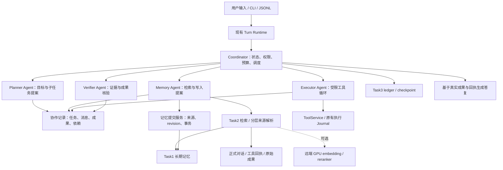

# MAPAS 长程多智能体协作：架构、算法与实施方案

> 项目名称于 2026-10-20 统一为 MAPAS。本文初稿日期为 2026-10-14；保留设计时点和原核查路径用于历史追溯。

日期：2026-10-14。状态：**用户已确认设计；P0–P1 实施记录见[阶段报告](../phases/multi-agent-p0-p1-20261014.md)**。下文保留初始设计及当时的研究范围，不将计划能力当成当前实现。

本方案依据课设 PDF 第 5–6 页“面向长程任务的多智能体记忆·组1”、当时的系统源码与正式维护报告，以及论文原文、正式出版页和官方仓库制定。用户已明确：聚焦代码与算法；GPU 在其他设备；整个 UI 已允许清理，本路线保留 CLI/JSONL。本文没有安排团队分工，没有启动系统搭建、GPU 部署、训练或真实 API 实验。

## 1. 推荐结论与项目定位

建议在现有系统上搭建 **“具有可溯源分层记忆和执行状态校验的长程多智能体协作系统”**，项目现名为 MAPAS。

第一版采用四个模型角色：Planner、Executor、Memory、Verifier；确定性 Coordinator 负责调度、权限、预算和持久化边界。模型仍可共同使用 DeepSeek，但拥有独立上下文、能力范围及结构化输出。当前设备管理状态、工具与评测；远端 GPU 可选地提供 embedding/reranker。先在单进程中实现可靠协作，再决定是否分布式运行。

主线是让任务所需的事实、约束、证据和执行结果能够正确跨角色、跨会话传递，并在输入变化或中间结果出错时停止错误传播。多 Agent 数量、图数据库、训练规模均不是第一版目标。

### 1.1 三个可检验的研究问题

| 问题 | 实验变量 | 判定证据 |
| --- | --- | --- |
| RQ1：相同资源上限下，协作是否有益，哪些任务有益？ | 强单 Agent、固定协作、按任务选择协作 | 整组任务成功率、约束满足率、实际成本及延迟；分顺序依赖/可并行任务报告 |
| RQ2：带来源与输入版本的交接，是否减少错误传播？ | 无来源摘要、来源交接、来源交接加派生输入校验 | 必需交接成功率、旧计划执行率、故障传播范围、修复成本 |
| RQ3：分层核验与选择性经验写入，是否改善后续行动？ | 现有记忆、摘要索引、摘要加原文核验、受验证的经验沉淀 | 后续任务行动表现、证据忠实度、错误经验复用率、修改/删除后的状态一致性 |

这是拟验证的问题，不是已经证明的提升，也不预先声明论文级原创性。已有研究已覆盖证据交接、依赖记忆、版本检查和协作边界；本项目先完成有依据的复现性实现，再依据外部对照结果确定能否提出更窄的改进。

### 1.2 课设要求与本方案的关系

PDF 规定论文研读、系统性总结以及 PPT、Word、录屏等汇报材料；允许基于论文思路进行课设实践。PDF 没有给出本组选题的精确代码验收门槛、固定实验预算或截止时间。因此，下文阶段与指标是本项目提出的工程/研究验收方案，不能写成老师已经要求的标准。当前先完成系统与实验设计，汇报材料后续基于真实实现和结果生成。

## 2. 论文研读结论及采用边界

### 2.1 组选六篇：分别解决什么问题

| 工作 | 核心认识 | MAPAS 中的用途 | 不能混淆的边界 |
| --- | --- | --- | --- |
| [MemoryArena](https://arxiv.org/abs/2602.16313) | 多会话子任务互相依赖，记忆需要帮助后续执行 | 主任务基准，按完整 task group 顺序执行 | 不是单纯历史问答；不能把各子任务打散独立评测 |
| [MemoBrain](https://aclanthology.org/2026.findings-acl.127/) | 用依赖结构维护有限上下文中的执行进展 | 对已经验证的子目标进行压缩，保留未解决依赖 | 本任务执行记忆不等于跨任务长期事实；其训练模型与提示词适配应分开标注 |
| [MAGE](https://arxiv.org/abs/2606.06090) | 将记忆组织成执行状态，验证摘要并隔离错误分支 | 子目标状态、原始行动观察、压缩、验证与选择性修复 | 逻辑状态回退不能撤销已发生的外部效果 |
| [TierMem](https://arxiv.org/abs/2602.17913) | 摘要先行，证据不足时访问带来源的原始记录 | 摘要/事实索引和原文核验两层检索 | 第一版不等于其 SFT+GRPO 训练复现；主评测与在线写回应分开 |
| [Experience-Following](https://aclanthology.org/2026.acl-long.27/) | 高相似经验可诱发模仿；错误与不适用的成功经验都可能污染后续行为 | 经验准入、适用条件、失败经验隔离、后续效用观察 | “执行成功”并不足以证明经验适用于另一任务；普通模型评委也可能错误 |
| [Near-Miss](https://aclanthology.org/2026.gem-main.30/) | 最终结果正确仍可能缺少必要的操作前核查 | 核查动作前的有效证据、权限与回执绑定 | 不把“最终答对”当成全过程合格；不直接运行模型生成的 guard 代码 |

阅读范围：六篇已获取有效 PDF，重点核查方法、实验协议和关键消融，而非逐条复核所有附录结果。MemoBrain、Experience-Following 使用 ACL 正式版本；Near-Miss 是 GEM workshop，TierMem 参考 arXiv/工作坊材料。MAGE 以查到的 arXiv v1 为依据。不同出版层级不混写。

### 2.2 扩展工作：会实质影响设计的选择

**AMA 是最直接的协作记忆参考。** Constructor/Retriever/Judge/Refresher 将不同记忆操作拆开，并利用多粒度记录与受限的迭代检索。本系统借鉴职责分离和不充分时的再检索，但把构造、检索和更新组织在 Memory 角色内，避免每轮无条件产生四次额外调用。其记忆管理协作不自动等于一般任务协作。来源：[AMA 正式论文](https://aclanthology.org/2026.findings-acl.152/)、[官方代码](https://github.com/Sherlockwz/AMA)。

**PlanFence 区分“当前读到的信息”与“计划形成时使用的信息”。** 第一版的计划和成果必须绑定生成时的输入版本；执行前检查这些输入是否仍有效，不能只检查检索结果是不是最新。采用集中式版本所有者的简单实现即可，不必复刻分布式 RPC 研究。该检查依赖完整、真实的输入记录，也不自动保证外部检查与执行原子性。来源：[PlanFence v2 方法与限制](https://arxiv.org/html/2609.03340v2)。

**MACE 已研究功能性依赖单元及角色化记忆呈现。** 将前置条件、行动和结果保留在一个经验单元中，比平铺片段更贴合本项目；其联合学习记忆组合与呈现方式属于后续候选，第一版先使用固定、可审计的呈现方式。不能将“有依赖图”宣称为新贡献。来源：[MACE 方法](https://arxiv.org/html/2609.21533v1)。

**ToCoMAS 将任务依赖、角色责任和记忆边界联系起来。** 可借鉴“先权限过滤，再语义检索”与跨责任边界的明确交接；第一版采用固定角色类型和由 Provider 提议的任务依赖，不进行在线自演化或自动修改工具权限。来源：[ToCoMAS 方法](https://arxiv.org/html/2609.37953v1)。

**CoMemBench 直接测试协作记忆共享与隔离。** 官方项目公开了带版本、类型和验证条件的任务交接及成对污染测试。不过公开问题数据与完整评测 oracle 的访问条件需要分别核实；不能仅拿公开样例便声称获得官方分数。适合作为协作专项评测候选，阶段 0 完成可运行性审查后决定范围。来源：[论文](https://arxiv.org/abs/2609.32192)、[官方项目与访问说明](https://comembench.world/)。

**CoMem 与 AIM 提醒我们区分角色私有经验和共享知识。** 可借鉴有条件共享与索引级隔离；本项目第一版仍是单用户系统，不据此承诺多用户服务，也不由模型自主把用户私人事实标为公共内容。来源：[CoMem](https://arxiv.org/abs/2609.15009)、[AIM](https://arxiv.org/abs/2609.12320)。两者本轮主要核查原始摘要，完整算法/代码复现需另做审查。

**协作收益受任务和基模型能力影响。** 2026 年 Nature Machine Intelligence 的受控研究说明应保持工具、任务及计算预算可比，并使用强单 Agent 对照；其经验阈值不是所有系统的通用定律。来源：[正式论文](https://www.nature.com/articles/s42256-026-01268-y)、[作者预印本](https://arxiv.org/abs/2512.08296)。

补充参考：[MAST 失败分类](https://arxiv.org/abs/2503.13657)用于失败归因；[ActiveMem](https://arxiv.org/abs/2606.10532)作为后续记忆工作者并行路线；[LongMemEval-V2](https://arxiv.org/abs/2605.12493)作为工作流/环境经验专项诊断。它们本轮主要核查摘要、任务定义或官方公开说明，尚未运行对应实验。

### 2.3 避免“论文拼装”

采用统一数据对象：**目标与约束 → 版本化证据 → 子任务成果 → 验证与执行回执 → 受控长期沉淀**。每项机制必须对应一个可观察失败和一个消融。第一版不引入全量 MemGoG、自演化拓扑、强化学习、多人隐私分类或大规模分布式队列。后续扩展由实验暴露的瓶颈驱动。

## 3. 当前源码与可复用基础

历史核查基准（2026-10-14，工作区路径已按 2026-10-20 的 MAPAS 名称规范化）：当时 HEAD 为 `425bb9da3764ae4a54b473d036d3484a65f8b0bc`，维护主体提交 `51dc607af81c7c4d7c680c07838cb1586776449a`。详细历史状态见 [维护报告](../maintenance/2026-10-14/Agent系统维护与升级准备报告.md)。历史 architecture 文档有冻结阶段描述，当前行为以当前架构文档和源码为准。

| 现有模块 | 当前责任 | 升级方式 |
| --- | --- | --- |
| `code/src/memory/app/console.py` | 会话、应用状态及用户入口 | 外部 turn 只接收一次；增加协作模式选择，不复制四个完整 App |
| `runtime/agent_runtime.py` | 任务绑定、Task2 检索、Task3 更新及上下文组装 | 保留用户 turn 生命周期，在其上方接入协作编排 |
| `agent/main_agent.py`、`agent/loop.py` | 推理、受限工具循环、执行结果 | Executor 适配已有 `run_loop`；不对子角色递归调用整套 chat turn |
| `agent/tooling.py`、`agent/journal.py` | 工具 schema、效果分类、确认、执行事实与恢复 | 各角色只获所需能力；回执与实际效果继续由原执行边界拥有 |
| `api/memory_manager.py`、`lifecycle/`、`storage/` | Task1 长期事实、revision、来源与原子生命周期提交 | Memory 产生提案，原有写入服务验证和提交 |
| `retrieval/` | Task2 只读召回、适用性、冲突与 EvidenceBundle | 保留协议、分数分离和 RRF；增加来源解析、可选远端检索及派生缓存 |
| `task_state/` | Task3 任务 ledger、checkpoint 与工作上下文 | 保留任务连续性；协作子任务状态采用扩展数据库并绑定 Task3 ID |
| `conversation/` | SQLite 正式对话记录 | 原始用户语句的权威来源解析入口 |
| `llm/llm_client.py` | DeepSeek 调用、结构化结果、重试及日志 | 独立角色 client 或请求级结果对象；加入系统级预算统计 |
| `runtime/events.py` | 用户端事件与重放 | 保持 CLI/JSONL 可观察性；它不是现成的可靠跨 Agent 消息队列 |

现有维护记录的 410 个测试通过及真实 API 试验，仅说明维护回归状态；不证明多 Agent 或新算法效果。本轮没有重跑这些 API 试验。

### 3.1 实施前必须处理的实际差距

1. 默认 builder 使用 BM25 与图检索，并没有默认接入远端 dense。可选 dense 当前每次召回重新嵌入全部当前记忆；直接连远端 GPU 会浪费传输和计算，先做按 revision/hash/model 复用的派生缓存。
2. 已处理的 ingestion event 会清空 raw_text/assistant_text，仅保留 hash 和有限来源片段。TierMem 原文层必须引用 ConversationRepository、工具 journal 和新增的不可变成果记录，不能依赖被清空的 ingestion 原文。
3. `PersonalAgentApp` 持有活动会话和任务等可变状态。角色隔离采用 RoleContext，不共享 App 的活动状态；初期只允许有限的只读分支并行。
4. LLM client 存在 `_last_usage`、`_last_reasoning_content` 等可变调用字段。不能用同一个实例同时服务多个角色并据此核算成本。请求结果必须绑定 call_id、role_id、usage 和 trace。
5. Task1 语义图与 Task3 checkpoint 都不等同于完整执行依赖图。新增协作成果/依赖记录，不改变原有记忆格式，不把语义图硬改成执行 DAG。
6. 长期记忆的原始消息绑定要统一支持 session_id、turn_id、message_id 与 hash；当前部分显式路径不能假定已有完整 message_id 绑定。

## 4. 目标架构与职责



### 4.1 四个模型角色

| 角色 | 输入与输出 | 能力范围 |
| --- | --- | --- |
| Planner | 用户目标、约束、可用工具与记忆摘要 → 结构化子目标、依赖、完成条件和证据需求 | 提议计划；不能自行扩大权限或执行外部效果 |
| Executor | 已批准子目标、授权上下文、工具 → 成果、工具回执、未解决问题 | 复用有限工具循环；可按计划实例化两个独立只读工作者 |
| Memory | 用户来源/任务需求、候选证据 → 检索提案、充分性判断、压缩提案、生命周期写入提案 | 不直接操作数据库，不将助手自述提升为用户事实 |
| Verifier | 原始要求、证据、成果和动作提案 → PASS / RETRIEVE_MORE / REPAIR / ABSTAIN 及问题绑定 | 单独取证核验；不因角色一致投票便认定真伪 |

四种角色可以使用相同模型。这里的区分来自输入、工具、状态和协议，而非四段名字不同的 system prompt。同模型错误可能相关，因此尽量使用工具原生校验器、执行回执及明确来源支持 Verifier。

Coordinator 是确定性服务：检查 DAG、ID、来源、生命周期、能力和资源上限，按合法状态调度，不承担关键词语义判断。语义分解、记忆筛选、冲突处理仍由符合 `AGENTS.md` 的 typed/versioned Provider 输出提议。

Tool Agent 在第一版体现为共享 ToolService 和 Executor 的执行能力，后续确有独立执行策略需求再拆成模型角色。Communication Layer 从第一版独立存在，使用有类型的消息与持久化交接记录。

### 4.2 完整执行链路

1. 外层 Runtime 记录真实用户 turn，并完成原有任务绑定。显式记忆修改/删除走现有 typed 请求与提交路径。
2. Planner 根据实际任务提议单角色执行或协作及子目标。首次版本只需固定四角色协作路线；自适应选择在基线稳定后加入。
3. Coordinator 校验任务图和权限。Memory 提供相应范围内的证据包；必要时按来源访问原文。
4. Executor 完成子目标，产出实际工具回执和成果。工具失败或结果未知必须保留相应状态。
5. Verifier 对关键成果或动作边界检查约束、来源、输入版本和结果。通过后才将成果标为 VERIFIED 并交给依赖节点。
6. 发现缺证据时受限再检索；发现错误时仅使受影响的依赖后继失效并提议修复。已发生的工具效果保持原始记录。
7. Memory 对经过核验的任务经验提出受控写入。用户长期事实和任务经验分别处理。
8. 最终回复列出已完成成果、失败/未知部分和必要的用户决策。只有持久化提交回执能支持“已保存/已修改/已删除”。

## 5. 记忆模型、数据所有权与接口

### 5.1 四类内容与两层访问

| 内容 | 权威位置 | 共享原则 |
| --- | --- | --- |
| 用户长期事实/偏好 | 原 Task1 memory.db | 同用户授权角色按当前有效 revision 使用；遵守删除和保留状态 |
| 当前任务执行状态 | Task3 与 coordination.db | 只向依赖任务暴露必要的、已核验的成果 |
| 跨任务程序性经验 | 新经验记录，带条件、版本、来源与结果 | 区分草稿、已验证成功、失败警示、已撤销；按适用条件检索 |
| 原始证据 | conversation.db、agent_journal.db、不可变成果记录 | 根据来源引用按需访问；权限和遗忘规则同样适用 |

两层访问指摘要/结构化索引优先、必要时取原始来源，不是创建两个互相独立的事实数据库。索引、向量和摘要为派生数据，不能成为绕过 Task1 生命周期的事实权威。

失败经验有保留价值，但只能作为有明确环境/前提的负面证据；不能与成功程序混排后直接执行。单任务通过也不能自动证明一套策略具备跨任务泛化能力，经验标记应区分“已验证此次结果”与“经过后续复用验证”。

### 5.2 初始接口草案

以下为待实现契约，不是当前已有类。统一提供 `schema_version`，跨角色传递 ID 与证据引用，不随意传整段私有历史。

| 契约 | 关键字段 |
| --- | --- |
| `RoleContext` | run_id、session_id、task_id、role_task_id、role_id、能力、允许范围、预算 |
| `PlanProposal` | 子目标、输入需求、依赖、责任角色、完成条件、待确认项 |
| `AgentMessage` | message_id、sender/receiver、kind、correlation_id、expected_state_version、payload_ref、scope |
| `EvidenceRef` | source_kind、source_id、revision_id/version、content_hash、span、authority、scope、有效性 |
| `EvidencePacket` | 原有个人记忆 EvidenceBundle、独立 ArtifactEvidence、需求、缺失项、冲突、成本 |
| `Artifact` | artifact_id、类型、内容 hash、produced_by、input_refs、verification_status、supersedes |
| `VerificationResult` | verdict、约束检查、证据引用、失败原因、repair_target、缺失信息 |
| `MemoryWriteIntent` | 原生命周期操作、target、expected_revision、用户来源、scope、幂等 ID |
| `MemoryWriteReceipt` | commit_id、实际操作、memory_id、new_revision、durable、error/unknown 状态 |
| `ModelCallResult` | call_id、role_id、结构化输出、usage、重试/状态、请求/响应模型标识、trace |

建议服务接口：`RoleRunner.run(context, input) -> RoleResult`；`MemoryService.recall(request) -> EvidencePacket`；`MemoryCommitService.commit(intent) -> Receipt`；`SourceResolver.resolve(ref, scope) -> SourceEvidence`；`ToolService.execute(request, context) -> ToolReceipt`；`CoordinationRepository.accept(message, expected_version)`。

工具回执、Verifier 结论、记忆提交回执属于不同概念，不能用一个通用 `success=True` 代替。

### 5.3 数据持久化和并发

新增 `coordination.db`，初始实体为 run、role_task、message/inbox、artifact、dependency、verification、experience 与 pending operation/outbox；按实际一致性需求合并表，避免提前过度建模。Task1、Task3、正式对话和执行 journal 保持已有格式与权威性。

内部消息至少一次接收，message_id 去重，状态转移采用版本检查。跨数据库写入使用持久化 pending operation、幂等提交与重启对账，不能承诺多个 SQLite 文件构成一个全局事务。外部工具也不能普遍承诺 exactly-once：可幂等的工具使用稳定请求 ID；不可幂等工具遇到执行结果未知时先对账/确认，不能自动再次执行。

在同一角色任务运行中，记录真正送入模型的公开输入版本，不能只接受模型自报的依赖。权限与能力由宿主发放，模型消息不能提升发送者身份、创建新的权限或扩大共享范围。

工具返回、检索记忆、文档和其他角色的消息均是有来源的数据，不能覆盖宿主指令和角色能力。沿用现有 prompt 的信任分层，在新交接路径验证伪造 sender、注入指令和越权 source_ref 的处理。hash/版本一致仅说明记录完整、当前，不能证明内容真实；事实真实性仍需要适当权威来源或原生环境验证。

## 6. 算法设计

### 6.1 A：按需求检索与证据充分性判断

Provider 为子目标提出 `EvidenceNeed`：所需实体、属性、时间/环境、证据权威和缺失信息。先确定允许的记忆/成果视图，再做检索；从禁止范围召回后才过滤，不作为合格实现。

第一版复用现有 BM25、dense protocol 和 RRF，避免直接将不可比分数相加。远端 dense 可使用 Qwen3-Embedding-0.6B，重排可使用 Qwen3-Reranker-0.6B。候选 20、最终 8 仅为开发起点，参数在 development 集固定；不是论文最佳参数。来源：[Qwen 官方实现与模型说明](https://github.com/QwenLM/Qwen3-Embedding)。

检索结果的相关性、当前适用性和证据充分性分开：相关记忆未必适用；适用候选也未必覆盖全部必要条件。Memory/Verifier 提议缺失项和 `ANSWER / ESCALATE / ABSTAIN`，确定性层校验证据 ID、范围、版本和资源上限。

升级时先根据已有 source_ref 读取原始来源，再执行受限深搜。第一版最多追加两轮检索（本方案工程选择，区别于 TierMem 原配置），若关键约束仍不确定就停止/询问，不根据“模型很自信”强行完成。

核验后的派生摘要可缓存，但必须保留来源、依赖版本和权限。主离线评测关闭跨样例写回；线上时间序列实验允许写回并单独统计成本。

### 6.2 B：证据与输入版本绑定的交接

交接包至少包含目标、已完成内容、约束、公开输入版本、证据引用、实际回执、未解决问题及接收者完成条件。Executor 收到“酒店已预订”的摘要而没有相应回执时，不能把它当成真实预订事实。

执行前区分三种版本：计划形成时的输入 `F`、执行者当前持有的输入 `C`、权威存储当前 head `H`。在声明的动作依赖范围内必须同时满足 `F = H` 和 `C = H`，并且证据有效、权限符合。发现不一致则重新取证/规划，随后再次检查。借鉴 [PlanFence](https://arxiv.org/html/2609.03340v2)，第一版集中式存储让检查更容易实现。

缺失依赖不能由猜测补齐。结构检查只能验证已记录输入，无法证明模型从未隐式依赖其他信息；因而保守记录提供给该角色的相关公开输入，配合语义验证。声明依赖的完整性是测量对象，而非先验完美保证。

版本核验与副作用提交之间仍可能有更新。内部记忆写入采用 expected_revision 的原子事务检查；外部操作尽量使用目标服务的条件写入/version token。外部服务不支持时记录校验时点及剩余窗口，不能宣称全局一致性已解决。

### 6.3 C：执行依赖图与局部修复

节点状态建议为 `PENDING / RUNNING / PRODUCED / VERIFIED / STALE / FAILED / BLOCKED / CANCELLED`。完成文本只生成 PRODUCED；满足证据/原生校验器条件后才成为 VERIFIED。消费者只接收其必需且有效的成果，分支间共享由依赖和授权共同控制。

过程记录是行动—观察与成果；压缩形成可审计子目标摘要，保留来源和依赖，不把模型的隐藏推理当成必须持久化的事实。

假设节点 v 的证据被纠正：保留 v 的历史，产生新版本，并将依赖它的后继标 STALE；无依赖关系的已验证成果保留。Verifier 提议修复目标，Coordinator 校验影响范围与预算后执行。压缩只折叠已核验片段，未完成约束、冲突与依赖闭包不能被折掉。

这结合 MemoBrain/MAGE 的执行记忆思想，但我们的 DAG、回执和本地修复属于适配实现；没有复现其全部训练、环境或指标。回退只改变当前可信执行路径，不能撤销已发邮件、支付或文件外部发布等实际效果。需要补偿时走原授权与工具机制。

### 6.4 D：选择性长期沉淀

用户事实仍走 Task1：来源必须是真实用户事件，Provider 提议操作，校验 ownership、当前 revision、source authority 后提交。助手反思、工具观察和环境经验不得伪装成用户确认的事实。

程序性经验记录任务类型、前置条件、环境/工具版本、关键步骤、输出条件、原始来源、验证结果及后续复用记录。新增门槛是证据完整和本次结果验证通过；条件是否适用于新任务由结构化语义评估判断。以 Experience-Following 为依据，不能把所有成功/失败轨迹无筛选长期保存为可执行建议。

后续复用结果仅是效用信号，不能将相关性当作因果贡献。初期做标记/隔离与人工可审计撤销，不凭低频次或单次失败自动删除用户事实。若探索效用评分，先在 development 的独立时间序列上评估，并与固定记忆、add-all 和选择性写入对照。

### 6.5 用户删除与原文层的治理

“不再作为长期记忆使用”与“删除原始对话”是不同操作，系统需保留 typed 请求中的操作语义。被 REMOVE 的长期记忆不得通过旧向量、压缩摘要、经验条目或原文升级检索重新注入。建立以源/事实 ID 为对象的派生失效和访问抑制关系；用户未要求清除原始对话时，正式历史可以留存，但不得借此复活已撤销长期事实。完整原文删除需要单独的既有/新增治理契约，不能悄悄改变原数据格式或 retention 含义。

### 6.6 预算、停止与过程核查

系统级预算覆盖所有角色、语义解释、记忆构造、检索、重排、验证、重试和最后生成，不能每个角色各自获得一份“完整系统预算”。预留终止答复预算；每次调用前预约资源、返回后结算。已有 Executor max_steps 仍生效，且受全局更紧上限约束。

起始配置可设同时运行的只读工作者最多 2、追加检索最多 2 轮、每个受影响分支修复最多 2 次；全局 calls/tokens/timeout 通过小规模 baseline 测量后在 development 固定，未经用户批准不开展大规模付费调用。

同一角色任务、相同输入版本和相同行动反复提交且没有新成果，触发结构性重复停止；需要语义解释的“没有进展”由 typed Provider 判断。未知结果、预算耗尽、证据不充分和任务失败分别记录。

Near-Miss 风格检查同时考虑结果和操作前证据：需要核查的变更是否绑定了正确实体、参数、当前状态与授权。等价且有效的证据可以满足要求，不为了指标强制一次无必要工具调用。第一版采用宿主定义并测试的结构 guard 与模型提议的语义检查，不在线执行模型生成程序。

## 7. 当前设备与远端 GPU

```text
当前 Windows 设备
  CLI/JSONL + Coordinator + 独立 RoleContext
  SQLite 权威数据 + 来源解析 + 工具执行 + 评测 harness
  DeepSeek API：规划、执行、记忆解释、核验
       |
       | 可选、有限批量的 HTTP/局域网服务调用
       v
远端 GPU 设备
  Embedding 服务 / Reranker 服务
  后续可选的小模型推理或 SFT
```

第一版 CPU+DeepSeek 就能运行。GPU 是检索效率/质量的可选后端，不是协作机制的前置条件。远端硬件、显存、系统和连接方式待实际接入阶段检查，不预设当前设备具有 CUDA。

embedding 缓存键至少包括 scope/owner、memory_id、revision_id、content_hash、模型精确 revision、dimension、normalization；原文/成果采用对应的不可变 source version 键。模型变化不能混用旧向量，更新/删除要撤销旧索引可见性。缓存可重建，仍以 SQLite 权威状态筛选读取。

远端契约包含 model identity、版本、维度、批次限制、健康状态、超时和错误类型。敏感数据只发向配置并授权的服务，远端缓存也适用生命周期。远端故障在产品中可显式切换到 BM25，并记录 degraded mode；正式实验中改变检索模式属于配置变化或基础设施异常，不能偷偷计入 hybrid 的正常结果。

训练路线后置：先收集 development 中的充分性判断、错误摘要、交接与核验数据，进行人工/原生证据质量审查，然后评估 router/verifier 的 SFT 或 MemoBrain 小模型推理。只有训练相对提示词方案表现和成本有收益才扩展。第一版不做 GRPO，不采用需要模型隐藏状态/KV cache 的闭源 API 不支持的协作方式。

## 8. 实验协议：先工程可靠，再比较方法

### 8.1 数据与环境选择

| 优先级 | 数据/环境 | 作用与进入条件 |
| --- | --- | --- |
| 主线 | [MemoryArena 官方仓库](https://github.com/ZexueHe/MemoryArena)的 travel，随后 web shopping | 验证跨会话后续行动；保留完整依赖 group。travel 先核实 CSV 下载；shopping 需产品数据及 Java/pyserini 索引。文本接口不需要恢复 UI |
| 协作专项候选 | [CoMemBench 官方项目](https://comembench.world/) | 核实公开资源、oracle 与评测授权；先尝试可运行的领域/样例。缺 oracle 时仅作接口与案例分析，不能声称官方评测成绩 |
| 记忆诊断 | [原版 LongMemEval](https://github.com/xiaowu0162/LongMemEval)的 longmemeval_s | 验证信息更新、跨会话与拒答；与任务成功指标分开；原版不等于 LongMemEval-V2 |
| 后续诊断 | [LongMemEval-V2](https://github.com/xiaowu0162/LongMemEval-V2) | 工作流、环境状态及 gotcha；先确认资源和评分方式，必要时采用注明范围的子集 |
| 工程必选 | 新建协作故障与生命周期案例 | 工具超时、旧版本计划、丢失交接、错误来源、重复消息、崩溃重启、删除记忆复活、GPU 断连 |

MemoryArena 的 progressive web search 需要较重语料/索引，不列为第一阶段必须完成项。官方 travel setup 描述 270 个任务组；第一版不会全量运行所有领域。采用公开子集必须记录筛选规则和 group_id，不能把 reduced-scale 分数写成官方全量结果。来源：[travel setup](https://github.com/ZexueHe/MemoryArena/blob/main/setup_travel.md)、[shopping setup](https://github.com/ZexueHe/MemoryArena/blob/main/setup_web_shopping.md)。

规模建议是先用 5–10 个完整组调通，再在可用领域选择约 40–60 个组做首轮比较；LongMemEval 首轮可按能力类型选约 60–100 个问题。以上是预算待定的建议，并非统计功效保证。正式参数在 development 固定，test 一次冻结，扩大样本仅根据预注册的资源计划进行。

切分按任务组、来源历史/用户及文档划分，禁止同一依赖链分散至 train/dev/test。评估时 Agent 只能获取按环境时序已公开的信息；未来子任务和 gold evaluator 状态不进入记忆、Planner 或训练数据。各方法从相同初始状态运行，允许组内按正式协议沉淀；不同测试组之间默认隔离。跨组在线学习另立时间序列协议。

### 8.2 核心对照：将协作收益与记忆收益拆开

在相同模型快照、工具和系统资源上限下使用 2×2 主对照：

| | 现有记忆路径 | 增强记忆路径 |
| --- | --- | --- |
| 强单 Agent，含自检/修复机会 | S-Legacy | S-Enhanced |
| 固定多 Agent 协作 | M-Legacy | M-Enhanced |

相同记忆列固定检索后端，比较协作因素；相同行比较记忆因素。远端 embedding/reranker 单独消融，避免升级 dense 与多 Agent 同时启用却把所有提升归于协作。单 Agent 获得与多 Agent 相同的系统上限和相应自检机会，实际用量也单独报告。

补充对照：不带证据的朴素多 Agent；固定协作与自适应协作；closest-work 透明版本校验基线。AMA 在共同可运行数据、同模型与明确适配条件下可作为记忆对照，若替换作者模型/配置就标注 adapted baseline，不称完整论文复现。PlanFence 式集中 lineage 检查可作为版本专项基线；完整 ToCoMAS/MACE 只有在官方代码、许可和算力均核实后再列为可运行方法。

全上下文、gold evidence 或 oracle verifier 可以用于诊断上限；它们看到的信息/成本与主方法不同，必须分栏报告，不能作为公平线上对照或输入生产 Agent。

### 8.3 消融与错误分解

逐项移除：原文升级检索、来源交接、派生输入版本校验、依赖局部修复、独立核验、选择性经验写入。第一轮选择与主假设最相关的 3 项，预算允许再补齐；不要同时删多个组件后无法归因。

失败按阶段归因：缺少生成/存储 → 召回失败 → 适用性/充分性失败 → 交接丢失 → 使用旧计划 → 工具执行失败 → 校验错误 → 不当沉淀 → 后续错误复用。先保存 trace 和证据，再做 MAST 风格类别归纳；模型输出的失败解释不是唯一判定依据。

### 8.4 指标、成本与统计

| 维度 | 指标 |
| --- | --- |
| 任务结果 | 子任务与整组成功率、约束满足率、原生环境得分 |
| 协作 | 必需交接成功、关键约束保留、验证节点完成、依赖错误传播及局部修复成本 |
| 记忆 | evidence recall、来源忠实度、修改/删除一致性、错误经验复用、在线效用轨迹 |
| 过程 | 有前置证据的合格变更比例、near-miss、未经授权/重复效果、错误成功声明 |
| 效率 | 所有角色及记忆阶段的输入/输出 tokens、API 次数/重试、实际费用、端到端/P95 延迟、原文升级次数、索引构建成本 |

构造记忆和索引的初始成本、每次查询成本、在线维护成本分别报告，并给出全生命周期合计/摊销；不能只展示最终回答输入 tokens。GPU 时间和网络延迟单列，不能将本地检索算作“免费”。

采用配对比较，对 task group / conversation history 做 cluster bootstrap 的 95% 区间，避免将同组子任务当成独立样本。代表性实验重复 2–3 次，记录随机种子及 API 的实际请求/响应模型标识、运行日期、温度和参数；固定 seed 不代表远端生成完全可复现。若区间过宽或收益不稳定，照实报告。

保留注册、启动、完成、失败及基础设施异常的全部数量。自己的端到端有效性报告包含所有注册任务；官方评分严格遵循其分母规则，并另给含基础设施失败的实际可用性。不要通过丢弃超时、换后端或只统计完成案例提高分数。CoMemBench 条件性隔离指标的分母门槛若不满足，按官方规则留空。

### 8.5 工程验收与研究验收分开

工程层要求在设计的测试范围内：零虚假持久化成功声明、零越权写入、零因重放导致的可幂等工具重复效果；旧 revision、被删除记忆及失效分支不能进入可信上下文；未知外部执行结果不自动重试。所有“零”都限定于具体测试案例，不宣称数学证明。

研究层不预定“提升 20%”之类目标。保留新机制需要公开任务上的可重复质量收益、成本下降或更好的质量—成本折中；若多 Agent 退化，保留强单 Agent 模式并报告适用边界。方法没有优势同样是合法结果。

## 9. 分阶段实施及停止条件

| 阶段 | 具体交付 | 通过门槛 |
| --- | --- | --- |
| P0：冻结基线与外部资源核实 | baseline 配置、源码/数据版本 manifest、MemoryArena 最小运行、CoMemBench 评测可用性记录 | 现有回归基准可复现；外部最小案例实际运行；数据/评测访问差距有明确记录 |
| P1：协作契约与真实最小链路 | Coordinator、RoleContext、类型消息、独立模型结果、持久化 role_task/artifact；四角色串行路径 | 至少一个实际工具子任务从规划到证据核验闭环；重放不重复用户入库；保留原单 Agent 入口 |
| P2：分层记忆与可靠写入 | SourceResolver、EvidencePacket、记忆提交回执、dense 派生缓存、经验分区 | 新增/修改/删除、来源核验、revision 失效及崩溃对账通过；不用 GPU 也可运行 |
| P3：依赖状态与协作修复 | 输入版本校验、Verified DAG、压缩、局部失效与修复；最多两个只读工作者 | 注入旧计划/错误分支/丢失交接时正确拦截与修复；外部效果不伪装回退 |
| P4：外部对照与消融 | 2×2 主对照、强单 Agent、重点消融、成本统计、失败案例与 CI | 全部结果来自实际运行；可由 manifest/命令重现；如无优势清楚说明，不靠自定义案例宣称 SOTA |
| P5：条件性增强 | 远端 GPU 重排、更大数据、router/verifier SFT、可选分布式服务 | 前四阶段稳定且瓶颈/收益证据支持，逐项增加，不一并启用全部复杂机制 |

GPU 检索服务可在 P2 后接入并做独立对照，不必等到 P5；P5 指更复杂的训练/部署路线。每阶段都同步正式架构、ADR、接口与故障语义，并运行适合该变化的回归。阶段门槛未通过就修复或缩小范围，不继续堆叠机制。

第一次获批实施的范围建议限定为 **P0–P1**：验证外部任务可运行，形成真正的四角色串行协作与持久化交接。通过后再进入分层记忆及依赖修复，避免先写出大量无法验证的框架。

### 9.1 代码组织草案

```text
code/src/memory/
  collaboration/          # 新增，独立于现有 Task1/2/3
    models.py             # 版本化契约与合法状态
    coordinator.py        # 调度、全局预算与停止
    roles.py              # Planner / Memory / Verifier 的 Provider 适配
    executor.py           # 原 AgentLoop 适配与隔离角色上下文
    repository.py         # 协作记录、版本防重与恢复
    messaging.py          # 有类型交接与 inbox/outbox
    context.py            # 证据需求、授权上下文、依赖闭包
    verification.py       # 结构 guard 与原生验证器接口
  retrieval/              # 小范围扩展来源解析和派生缓存
  runtime/                # 协作入口与装配，保留原入口
  agent/                  # 复用现有工具及 journal
code/scripts/             # 后续 benchmark adapter / run / aggregate
code/tests/               # 对真实新边界的集成与恢复测试
docs/research/            # 本方案、来源与正式实验协议
docs/architecture/        # 实施后更新当前架构
docs/decisions/           # 新 ADR，不覆盖既有决策历史
```

这是组织建议，不预先创建空模块。模块仅在具备实际职责和可验证交付时加入。首版优先使用现有 Python 与 SQLite，暂不迁移到一个新的全套 Agent 框架，不恢复前端，不改 Task1/2/3 原数据格式。

### 9.2 实验产物

正式结果记录 config、数据/代码版本与 hash、group/split IDs、环境、模型标识、原始状态分类、脱敏 trace、逐样例结果、汇总 CSV/JSON、置信区间和图表。可复现的小体积正式结果进入仓库；原始私人会话、密钥、大型权重/索引、临时下载和缓存保持在 Git 之外。论文下载不自动当作可再分发附件，正式参考使用原始链接和版本/hash。

## 10. 待确认的实施决定

1. 采用 **四模型角色 + 确定性 Coordinator + 共享 ToolService**，先单进程串行协作，保留强单 Agent 对照。
2. 采用 **来源与输入版本绑定的交接、分层原文核验、依赖失效与局部修复、选择性经验沉淀**；分阶段实现，不改变既有长期记忆格式。
3. 主任务使用 **MemoryArena**；CoMemBench 先验证资源和评分器可用性后纳入专项；LongMemEval 用作记忆诊断。所有实验以系统预算匹配和真实结果为准。
4. **当前设备调度/存储/评测 + DeepSeek 推理 + 可选远端 GPU 检索**；训练后置。首次代码搭建范围为 P0–P1。

用户确认以上路线后开始实施。确认设计不等于授权任意规模的付费实验；先完成可审查的最小系统与预算测量，再明确正式实验规模。

## 11. 本轮研究与验证范围

已核查课设 PDF 全文，并视觉查看选题页；读当前入口、执行循环、存储/检索关键路径、仓库规则及维护/架构文档。已获取并重点研读六篇组选论文、AMA 与协作 scaling 预印本；对 9 月 PlanFence/MACE/ToCoMAS 读原始 HTML 的方法与限制，对 CoMemBench 核查原始摘要及官方访问/指标说明。补充工作阅读深度见同目录 sources.json。

本轮仅产出设计文档和来源记录；没有运行论文方法、生成多 Agent 效果数据、修改生产代码、使用 DeepSeek API、连接远端 GPU 或推送 GitHub。论文下载与文本抽取在被忽略的 `.runtime/multi-agent-plan-20261014/` 中，供本地核查。
